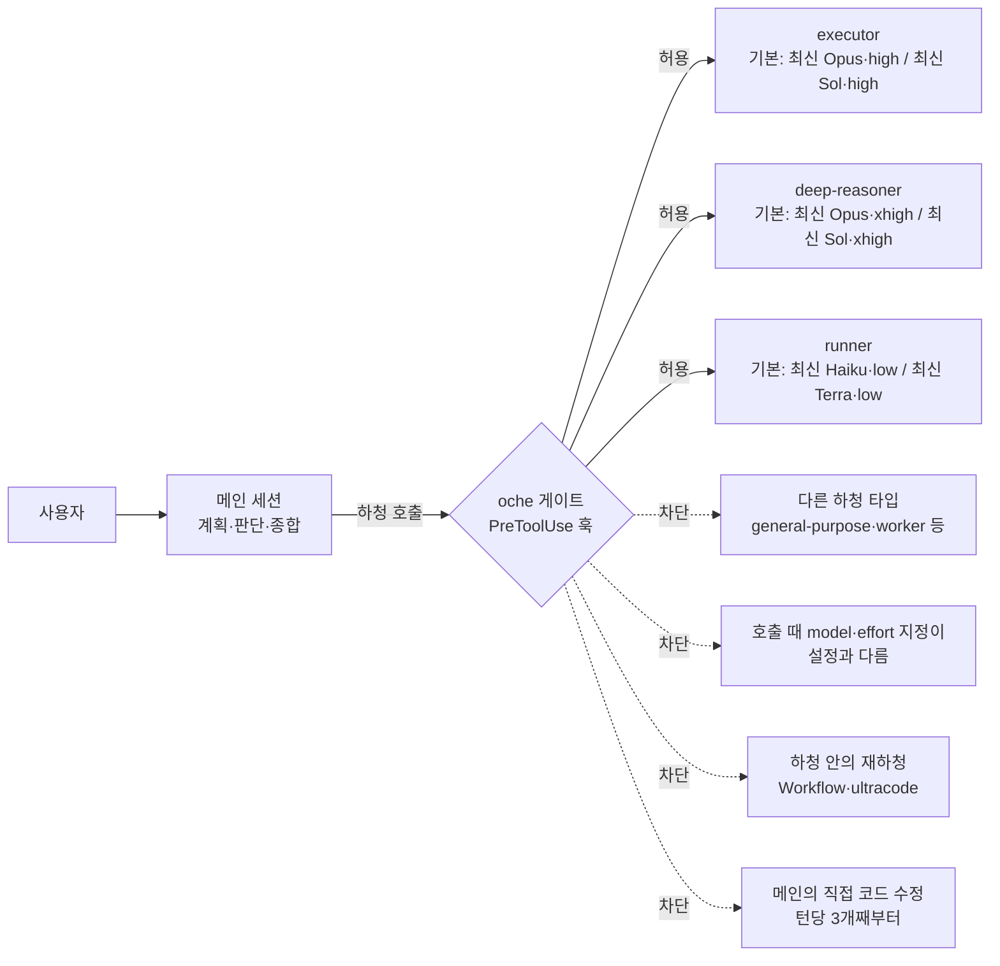
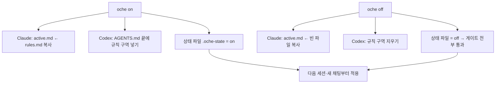
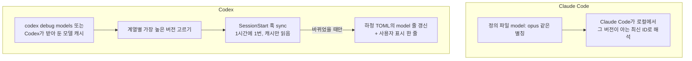
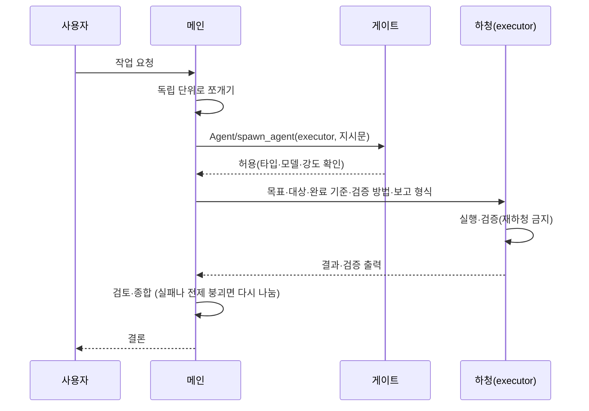

# suhan-orchestration

> **English summary.** An installer that sets up an "orchestrator + three fixed sub-agents + enforcing hook + on/off switch"
> configuration for **Claude Code** and **OpenAI Codex** (CLI and the Codex inside the ChatGPT desktop app).
> The main session plans and judges; implementation goes to three sub-agent roles (`executor`, `deep-reasoner`, `runner`)
> whose model and reasoning effort *you* choose from the terminal (`oche`, with a keyboard TUI). A PreToolUse hook blocks
> other sub-agent types, call-time model/effort overrides, nested spawning and multi-agent fan-out, so a session cannot
> quietly burn your top-tier model quota. Sub-agent models follow new releases automatically without spending LLM tokens.
> Python 3.8+ standard library only; tested on macOS only; Linux uses the same POSIX paths but is untested, and Windows is only emulated in tests. Documentation is in Korean.

메인 세션은 생각하고, 정해진 일은 하청 세 역할이 합니다. 하청의 모델·강도는 사람이 터미널에서 정하고,
훅이 그 약속을 강제합니다. Claude Code와 Codex(CLI·ChatGPT 앱) 둘 다, 또는 한쪽에만 설치할 수 있습니다.

---

## 1. 빠른 시작

### LLM에게 설치 맡기기 (권장)

Claude Code나 Codex 세션을 열고 아래 문장을 그대로 붙여 넣습니다. 자세한 절차는 [INSTALL-FOR-LLM.md](INSTALL-FOR-LLM.md)에 있습니다.

```text
https://github.com/suhan-dev/suhan-orchestration 의 INSTALL-FOR-LLM.md 를 읽고 그 절차대로 설치해 줘.
먼저 어디에(Claude Code / Codex / 둘 다) 설치할지 나에게 물어봐.
```

### 직접 설치

macOS·Linux:

```bash
git clone https://github.com/suhan-dev/suhan-orchestration
cd suhan-orchestration
python3 install.py plan                 # 아무것도 바꾸지 않고 감지 결과·할 일·충돌을 보여 줌
python3 install.py install --only claude   # Claude Code에만
python3 install.py install --only codex    # Codex(CLI + ChatGPT 앱)에만
python3 install.py install --all           # 감지된 것 전부
python3 install.py verify
```

Windows(PowerShell, 실기기 시험 전 — [08-limitations](docs/08-limitations.md) 참고):

```powershell
git clone https://github.com/suhan-dev/suhan-orchestration
cd suhan-orchestration
py -3 install.py plan
py -3 install.py install --only claude   # 또는 --only codex / --all
py -3 install.py verify
```

`--only`·`--all` 없이 터미널에서 직접 실행하면 어디에 설치할지 묻습니다.

### 켜고 새 세션 열기

설치하면 켜진 상태입니다. 다음에 여는 세션부터 적용됩니다.

| 도구 | 적용 시점 | 사람이 한 번 할 일 |
|---|---|---|
| Claude Code | 새 `claude` 세션 | 없음 |
| Codex CLI | 새 `codex` 세션 | `/hooks`에서 oche 훅 2개 신뢰 |
| ChatGPT 앱의 Codex | 새 Codex 채팅 | 입력창의 **Review hooks** 또는 **Settings > Hooks**에서 oche 훅 2개 신뢰 |

```bash
oche on      # 켜기
oche off     # 끄기
oche         # 화면(TUI) 또는 현황판
```

### `oche`라는 이름이 이미 쓰이고 있을 때

설치 전에 확인합니다. 무언가 나오면 다른 이름으로 설치합니다.

```bash
type oche                # macOS·Linux
```
```powershell
Get-Command oche         # PowerShell
where oche               # cmd
```

```bash
python3 install.py install --all --command-name orch
```

그 뒤로는 모든 명령의 `oche`를 그 이름(`orch on`, `orch executor` …)으로 바꿔 읽습니다. 이름을 나중에 바꾸려면
같은 명령을 새 이름으로 다시 실행합니다(옛 이름 명령은 지워지고 설정은 유지). 자세한 것은 [01-install](docs/01-install.md#oche가-이미-쓰이고-있을-때).

---

## 2. 사용법

### `oche` 화면 (TUI)

터미널에서 `oche`를 인자 없이 실행하면 키보드로 조작하는 화면이 열립니다. 왼쪽은 메뉴, 오른쪽은 지금 구성도입니다.

```text
 oche · 하청 오케스트레이션 1.1.3  ·  프리셋: 기본

   Claude Code                             ● ON          ╭──────────────────────────╮
 ❯   executor                       opus · high          │          사용자          │
     deep-reasoner                 opus · xhigh          ╰──────────────────────────╯
     runner                         haiku · low                       ↓
                                                         ╭──────────────────────────╮
   Codex                                   ● ON          │    메인 · Claude Code    │
     executor                   최신 sol · high          ╰──────────────────────────╯
     deep-reasoner             최신 sol · xhigh                       ↓
     runner                    최신 terra · low          ╭──────────────────────────╮
                                                         │        게이트 ON         │
   프리셋                                  기본          ╰──────────────────────────╯
   모델 목록 갱신                                  ↓              ↓              ↓
   자가 시험                                ╭──────────────╮╭──────────────╮╭──────────────╮
   나가기                                   │executor      ││deep-reasoner ││runner        │
                                            │claude-opus-… ││claude-opus-… ││claude-haiku-…│
                                            │high          ││xhigh (extra) ││low           │
                                            ╰──────────────╯╰──────────────╯╰──────────────╯
 ↑↓ 이동 · Enter 선택 · q 나가기
```

| 키 | 동작 |
|---|---|
| ↑ ↓ (또는 k j) | 이동 |
| Enter (또는 →) | 선택. ON/OFF 줄은 바로 토글, 역할 줄은 모델 선택 → 강도 선택 → 적용 |
| Esc · ← · q | 뒤로. 홈에서 q는 종료 |
| 글자·Backspace | "직접 입력" 칸에서 모델 ID 입력 |

- 역할을 고르면 모델 목록(현재 값 ✔, 커서 ❯)이 열리고, Enter를 누르면 그 모델이 지원하는 강도만 보입니다(ultra 없음).
  강도에서 Enter를 누르면 바로 적용되고 아래 상태줄에 "적용됨 — 다음 세션부터"가 뜹니다.
- `oche executor`처럼 역할 이름으로 실행하면 그 역할의 모델 선택 화면이 바로 열리고, 고르면 끝납니다.
- 파이프·리다이렉트·CI·LLM이 실행할 때는 화면을 띄우지 않고 텍스트로 동작합니다. `oche --plain`으로 강제할 수 있습니다.
- 화면에서 하는 일은 아래 비대화형 명령과 같은 함수를 부릅니다. 결과가 같습니다.

### 역할별 모델·강도 바꾸기

역할은 세 개로 고정이고, 각 역할의 모델과 강도는 자유롭게 정합니다. 정의 파일·게이트에 즉시 반영되고 다음 세션부터 적용됩니다.

```bash
oche claude executor sonnet medium     # Claude Code의 executor를 최신 Sonnet·medium으로
oche claude runner haiku low
oche codex executor sol high           # Codex의 executor를 최신 Sol 계열·high로
oche codex runner terra low
oche runner haiku medium               # 한쪽만 설치돼 있으면 대상 생략 가능
oche reset                             # 전부 기본값으로
oche reset codex runner                # 하나만 기본값으로
```

- 계열 이름(`opus`, `sol` 등)을 쓰면 같은 계열의 새 버전이 나올 때 저절로 따라갑니다. 전체 ID를 쓰면 그 버전에 고정됩니다.
- 쓸 수 있는 계열과 지금 매핑은 `oche models`로 봅니다. 새 계열이 나오면 목록에 저절로 나타나고 알림이 뜹니다(역할은 바꾸지 않음).

### 프리셋

역할 3개의 모델·강도 묶음을 이름으로 한 번에 바꿉니다. 설치된 대상(Claude Code·Codex) 모두에 적용되고, 대상을 적으면 그쪽만 바꿉니다.

| id | 이름 | Claude Code (executor / deep-reasoner / runner) | Codex (executor / deep_reasoner / runner) |
|---|---|---|---|
| `default` | 기본 | opus·high / opus·xhigh / haiku·low | sol·high / sol·xhigh / terra·low |
| `saver` | 절약 | sonnet·medium / opus·high / haiku·low | terra·medium / sol·high / luna·low |
| `max` | 최대 | opus·xhigh / opus·max / haiku·medium | sol·xhigh / sol·max / terra·medium |

```bash
oche preset                     # 목록(지금 설정과 일치하는 것에 ✔)
oche preset use saver           # 절약으로(Claude·Codex 모두)
oche preset use max codex       # Codex만 최대로
oche preset save 내조합         # 지금 설정을 사용자 프리셋으로 저장
oche preset use 내조합
oche preset delete 내조합
```

TUI에서는 홈의 **프리셋** 메뉴에서 고르고 Enter, 또는 "지금 설정 저장"에서 이름을 입력합니다. 현황판과 TUI 상단에
`프리셋: 절약`(일치하는 것이 없으면 `프리셋: 사용자 지정`)이 보입니다.

### 명령 요약

| 명령 | 하는 일 |
|---|---|
| `oche` | 터미널이면 TUI, 아니면 현황판(대상별 ON/OFF, 역할 \| 모델(설정 → 실제) \| 강도, 경고) |
| `oche on` / `oche off` `[claude\|codex\|all]` | 켜기/끄기(다음 세션·새 채팅부터) |
| `oche status` | 현황판 + 부품 점검 `[OK]`/`[--]` + 마지막 sync |
| `oche models` | 계열별 최신 모델과 역할 매핑 |
| `oche <역할>` | 모델·강도 고르기(TUI 또는 번호 선택) |
| `oche [claude\|codex] <역할> <모델> [<강도>]` | 바로 바꾸기 |
| `oche reset [claude\|codex] [<역할>]` | 기본값으로 |
| `oche preset` | 프리셋 목록(일치하는 것에 ✔) |
| `oche preset use <이름> [claude\|codex]` · `save <이름>` · `delete <이름>` | 프리셋 적용 · 지금 설정 저장 · 사용자 프리셋 지우기 |
| `oche update [claude\|codex]` | 모델 목록 갱신(새 계열 알림), Codex 최신 계열 다시 정하기 |
| `oche pin <대상> <역할> <ID>` / `oche unpin <대상> <역할>` | 특정 버전 고정 / 고정 풀기 |
| `oche selftest [claude\|codex]` | 게이트 시험(켜짐·꺼짐 모두, 원래 상태로 되돌림) |
| `oche version` · `oche help` | 버전 · 도움말 |

자세한 사용법은 [02-usage](docs/02-usage.md).

---

## 3. 구성도와 동작 방식

### 전체 구성



### on/off



### 하청 모델 자동 최신화 (LLM 토큰을 쓰지 않음)



### 위임 한 건의 순서



### Claude Code와 Codex의 차이

| 항목 | Claude Code | Codex (CLI·ChatGPT 앱) |
|---|---|---|
| 규칙을 불러오는 법 | `CLAUDE.md`의 `@~/.claude/oche/active.md` | `AGENTS.md`(또는 `AGENTS.override.md`) 안의 표시 구역 |
| 하청 정의 | `~/.claude/agents/*.md` (`model:`·`effort:`) | `~/.codex/agents/*.toml` (`model`·`model_reasoning_effort`) |
| 게이트 등록 | `settings.json` PreToolUse | `hooks.json` PreToolUse (+ SessionStart sync) |
| 훅 신뢰 | 필요 없음 | **사람이 한 번 신뢰해야 돈다** |
| 다중 에이전트 팬아웃 | Workflow 도구를 훅으로 **차단** | `ultra`는 강도 설정이라 훅이 못 봄 → **규칙으로만** 막음 |
| 모델 자동 최신화 | 별칭을 Claude Code가 해석 | 모델 목록 → sync 훅 |
| 하청 안 판별 | `agent_id`/`agent_type` | 같음(0.171.0 미만이면 저하 모드) |
| 턴 id(수정 개수 세기) | `prompt_id` | `turn_id` |

---

## 4. 왜 이렇게 하는가

- **최상위 모델 토큰은 비싸고 한도가 있습니다.** 생각이 필요한 일에만 최상위 모델을 쓰고, 정해진 일은 그보다 싼 모델로 돌립니다.
- **하청은 메인 모델을 물려받는 함정이 있습니다.** 범용 하청 타입(`general-purpose`, `worker` 등)은 부모 모델로 돕니다.
  메인급 모델로 하청을 수십 건 띄워 주간 사용 한도의 절반을 며칠 만에 쓴 사고가 실제로 있었습니다.
- **팬아웃은 폭주합니다.** 다중 에이전트 모드는 한 번에 수십 개를 띄웁니다.
- **규칙만으로는 지켜지지 않습니다.** 모델은 지시를 잊거나 "이번만"이라며 어깁니다. 그래서 훅으로 강제합니다.
- **생각하는 쪽과 실행하는 쪽을 나눕니다.** 메인은 설계·판단·종합, 하청은 목적 하나짜리 실행.

자세한 배경은 [04-why](docs/04-why.md).

---

## 5. 자주 묻는 것

**자동 최신화에 LLM 토큰이 드나요?** 들지 않습니다. Claude Code는 정의 파일의 별칭(`opus` 등)을 Claude Code가 로컬에서
해석합니다. Codex는 로컬 스크립트(sync 훅)가 Codex가 이미 받아 둔 모델 캐시 파일만 1시간에 한 번 읽습니다(하위 프로세스·네트워크 없음).
`oche update`와 설치 때의 `codex debug models`는 모델 목록 요청일 뿐 모델 호출이 아닙니다. 규칙 문서에도 모델에게 버전을
확인하라는 지시는 넣지 않았습니다.

**규칙 문서는 매 세션 얼마나 차지하나요?** 켜져 있을 때 약 4~5 KB입니다. 꺼 두면(`oche off`) Claude는 한 줄짜리 빈 파일,
Codex는 0바이트입니다.

**메인 모델도 바꾸나요?** 아니요. 메인 모델과 강도는 사용자가 도구에서 직접 고릅니다. oche는 하청만 다룹니다.

**하청을 메인급 모델로 쓰고 싶으면?** `oche claude deep-reasoner fable max`처럼 사용자가 정하면 됩니다. 막는 것은 모델이
*호출 때 임의로* 바꾸는 것뿐입니다.

**Claude 역할을 Codex 모델로 돌릴 수 있나요?** 실험적으로 됩니다(다리 하청). [05-models-and-effort](docs/05-models-and-effort.md#다리-하청실험적).

**끄면 완전히 원래대로인가요?** 규칙을 불러오지 않고 게이트가 모든 호출을 통과시킵니다. 하청 정의 파일 세 개는 남아 있지만 쓰라는 규칙이 없습니다.
완전히 빼려면 `python3 install.py uninstall`.

## 6. 한계

훅은 완전한 보안 경계가 아니라 가드레일입니다(오류 시 통과, 호스팅 도구는 훅을 거치지 않음). Codex `ultra`는 규칙으로만 막습니다.
"세션당 동시 하청 1개"도 규칙으로만 지킵니다. Windows는 시험 환경에서 흉내만 냈습니다. 전체 목록은 [08-limitations](docs/08-limitations.md).

## 7. 문서 목차

1. [01-install](docs/01-install.md) — 설치·업데이트·제거, 이름 충돌, PATH
2. [02-usage](docs/02-usage.md) — TUI, 역할 바꾸기, on/off, 명령 전체
3. [03-architecture](docs/03-architecture.md) — 파일 배치, 게이트 판정표, 상태 파일
4. [04-why](docs/04-why.md) — 배경과 설계 원칙
5. [05-models-and-effort](docs/05-models-and-effort.md) — 모델·강도 대응표, 자동 최신화, 고정, 다리 하청
6. [06-codex-and-chatgpt-app](docs/06-codex-and-chatgpt-app.md) — Codex CLI·ChatGPT 앱, 훅 신뢰, 저하 모드
7. [07-troubleshooting](docs/07-troubleshooting.md) — 문제 해결
8. [08-limitations](docs/08-limitations.md) — 한계와 시험 범위
- [INSTALL-FOR-LLM.md](INSTALL-FOR-LLM.md) — LLM에게 주는 설치 지시서
- [CHANGELOG.md](CHANGELOG.md) — 변경 기록

라이선스: MIT ([LICENSE](LICENSE)).
