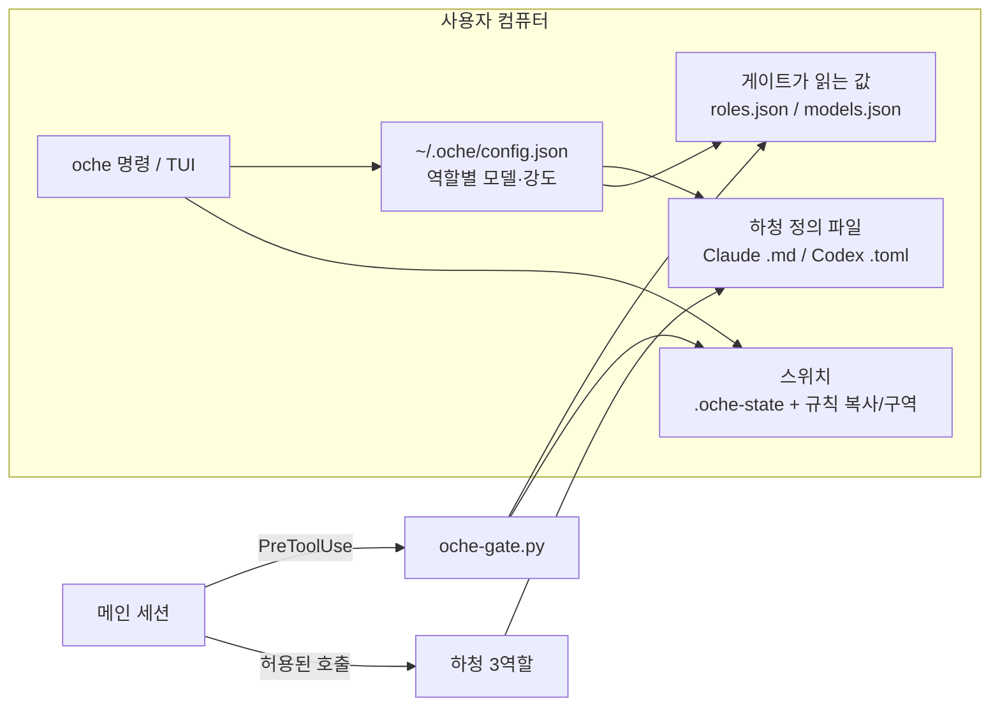
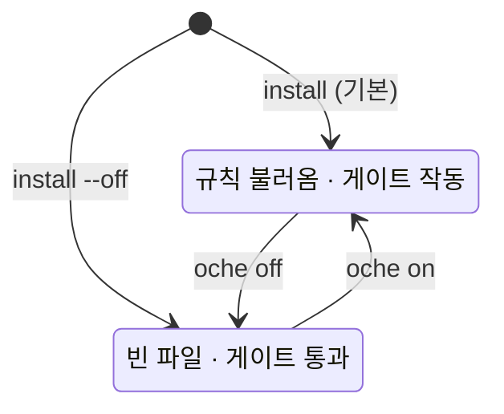
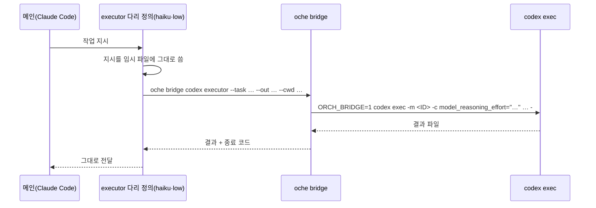

# 03. 구성과 동작 방식

## 큰 그림

- 설정의 원본은 `~/.oche/config.json`입니다. 정의 파일과 게이트가 읽는 파일은 항상 여기서 만들어 씁니다.
- 게이트는 매 도구 호출마다 상태 파일을 먼저 봅니다. `on`이 아니면 바로 통과합니다. 그래서 등록은 한 번이고, 동작 여부는 스위치가 정합니다.
- 심링크를 쓰지 않습니다(Windows는 심링크에 관리자 권한이 필요). 규칙·정의 파일은 모두 실제 파일로 복사합니다.

## 파일 배치

### 공용

| 경로 | 내용 |
|---|---|
| `~/.oche/config.json` | 명령 이름, 대상별 폴더·버전, 역할별 `{model, effort}`, Codex 자동 갱신 여부·저하 모드 |
| `~/.oche/catalog.json` | 대상별 `{families: {계열: 최신ID}, models, efforts, source, tool_version, updated_at}` |
| `~/.oche/log.txt` | 기록 |
| `~/.oche/assets/` | `install.py`·`oche/` 사본 |
| `~/.oche/bin/oche.py` | `assets/oche/bin/oche.py`를 실행하는 작은 파일 |
| `~/.local/bin/oche` | POSIX sh 래퍼(절대경로 python3) |
| `%USERPROFILE%\.local\bin\oche.cmd`·`oche.ps1` | Windows 래퍼(`py -3`, 상대경로 `%~dp0..\..\.oche\bin\oche.py`) |

### Claude Code (`~/.claude` 또는 `$CLAUDE_CONFIG_DIR`)

| 경로 | 내용 |
|---|---|
| `oche/rules.md` · `oche/empty.md` | 규칙 원본 · 꺼졌을 때의 빈 파일 |
| `oche/active.md` | 켜지면 규칙, 꺼지면 빈 파일의 복사본 |
| `oche/hooks/oche-gate.py` | 게이트 |
| `oche/agents/*.md` | 하청 정의 원본 |
| `oche/roles.json` | 게이트가 읽는 역할별 설정값·정의 파일 값 |
| `oche/manifest.json` | oche가 쓴 정의 파일의 해시(남의 파일과 구별) |
| `oche/state/` | 세션별 수정 개수 기록 |
| `agents/{executor,deep-reasoner,runner}.md` | 하청 정의(실제 파일) |
| `.oche-state` | `on`/`off` |
| `CLAUDE.md` | 끝에 두 줄: `<!-- oche-loader: … -->`, `@~/.claude/oche/active.md` |
| `settings.json` | `hooks.PreToolUse`에 matcher `Write\|Edit\|NotebookEdit\|MultiEdit\|Bash\|Workflow\|Agent\|Task` 항목 |

### Codex (`~/.codex` 또는 `$CODEX_HOME`, CLI와 ChatGPT 앱 공용)

| 경로 | 내용 |
|---|---|
| `oche/rules.md` | 규칙 원본 |
| `oche/hooks/oche-gate.py` · `oche/hooks/oche-sync.py` | 게이트 · 모델 갱신(SessionStart) |
| `oche/models.json` | 역할별 설정값·실제 모델·강도·출처 |
| `oche/gate.json` | `{"subagent_fields": true/false}` (저하 모드) |
| `oche/state/` | 수정 개수 기록, `sync.stamp` |
| `agents/{executor,deep-reasoner,runner}.toml` | 하청 정의(첫 줄 `# oche-managed`) |
| `.oche-state` | `on`/`off` |
| `AGENTS.md` 또는 `AGENTS.override.md` | `<!-- oche:begin … -->` ~ `<!-- oche:end -->` 구역 |
| `hooks.json` | `PreToolUse`(matcher `^(apply_patch\|.*spawn_agent\|Agent)$`, timeout 10 — 실제 0.171.0은 하청 도구를 `collaborationspawn_agent`로 보냄) · `SessionStart`(matcher `startup\|resume`) |

## 훅 명령

| 대상 | macOS·Linux | Windows |
|---|---|---|
| Claude Code | `"/opt/homebrew/bin/python3" "/…/oche-gate.py"` (버전 없는 `python3`의 절대경로) | py 런처가 있으면 `py -3 "C:/…/oche-gate.py"`, 없으면 `"shell": "powershell"` + `& "C:/…/python.exe" "C:/…/oche-gate.py"` |
| Codex | `command`: 위와 같은 POSIX 형태 | `commandWindows`: `py -3 "C:\…\oche-gate.py"`, py가 없으면 `"<python.exe>" "<gate>"` |

- ChatGPT 앱은 GUI라 PATH가 짧습니다. 그래서 POSIX 명령은 절대경로 python을 씁니다(`sys.executable`처럼 버전이 붙은 경로는 쓰지 않음).
- Claude Code는 Windows에서 훅 명령을 Git Bash(없으면 PowerShell)로 실행합니다(공식 hooks 문서). `py -3 "C:/…"`는 두 셸 모두에서
  돌고, 슬래시 경로는 Git Bash의 역슬래시 해석 문제를 피합니다. py 런처가 없을 때는 문서가 권하는 `shell: powershell` + `&` 형태를 씁니다.

## 게이트 판정 순서

Claude Code(`oche-gate.py`):

1. `.oche-state`가 `on`이 아니면 통과.
2. 환경변수 `ORCH_BRIDGE=1`(다리 하청이 띄운 CLI 안)이면 `Agent`·`Task`·`Workflow` 차단, 나머지 통과(수정 개수 안 셈).
3. 입력에 `agent_id`/`agent_type`이 있으면(하청 안) `Agent`·`Task`·`Workflow` 차단, 나머지 통과.
4. `Workflow` 차단.
5. `Agent`/`Task`: `subagent_type`이 세 역할이 아니면 차단. `model`이 있으면 그 역할의 설정값(또는 정의 파일 값)과 같을 때만 통과.
   `effort`가 있으면 설정 강도와 같을 때만 통과(ultra는 늘 차단).
6. `Edit`·`Write`·`NotebookEdit`·`MultiEdit`로 코드 파일(확장자 목록)을 고칠 때: `prompt_id`가 있으면 그 턴에 고친 파일을 세고 3개째부터 차단.
   같은 파일 재수정은 세지 않음. 문서·설정 파일은 세지 않음. `Bash`는 통과.
7. 어떤 오류든 통과(fail-open).

Codex(`oche-gate.py`): 같은 순서에서 이름이 `spawn_agent`로 끝나는 도구(실제 이름 `collaborationspawn_agent`, 별칭 `Agent`)·`agent_type`·`reasoning_effort`·`apply_patch`의 패치 본문
(`*** Add File:`/`Update File:`/`Delete File:`/`Move to:` 줄)·`turn_id`를 씁니다. `gate.json`의 `subagent_fields`가 `false`면
3번(하청 안 판별)과 6번(수정 개수)을 끕니다.

모델 계열 이름(fable, astra 등)으로 판정하지 않습니다. "세 타입만 허용 + 호출 때 지정한 model·effort는 설정값과 같아야 함"만 봅니다.
그래서 새 계열이 나와도 게이트를 고칠 필요가 없습니다.

## 스위치

## 다리 하청 (실험적)

Codex 역할을 Claude 모델로 정하면 대칭으로 `claude -p --model … --effort …`를 부릅니다. 자세한 것은 [05](05-models-and-effort.md#다리-하청실험적).

## 설치기의 안전 장치

- 원래 있던 파일은 바꾸기 전에 `<파일>.bak_oche_<YYYYmmdd-HHMMSS>`로 백업합니다(한 번 실행에 한 번씩).
- 모든 쓰기는 같은 폴더의 임시 파일에 쓰고 `os.replace`로 바꿉니다. 사용자 파일이 심링크면 원본을 고칩니다.
- 여러 번 실행해도 줄·훅 항목이 늘지 않습니다(oche 항목은 명령 문자열의 `oche-gate`/`oche-sync`로 알아보고 제자리에서 바꿈).
- 남의 파일은 덮어쓰지 않습니다: 같은 이름의 하청 정의는 `--force-agents`가 있을 때만 백업 후 교체, 명령 이름 충돌은 거부.
